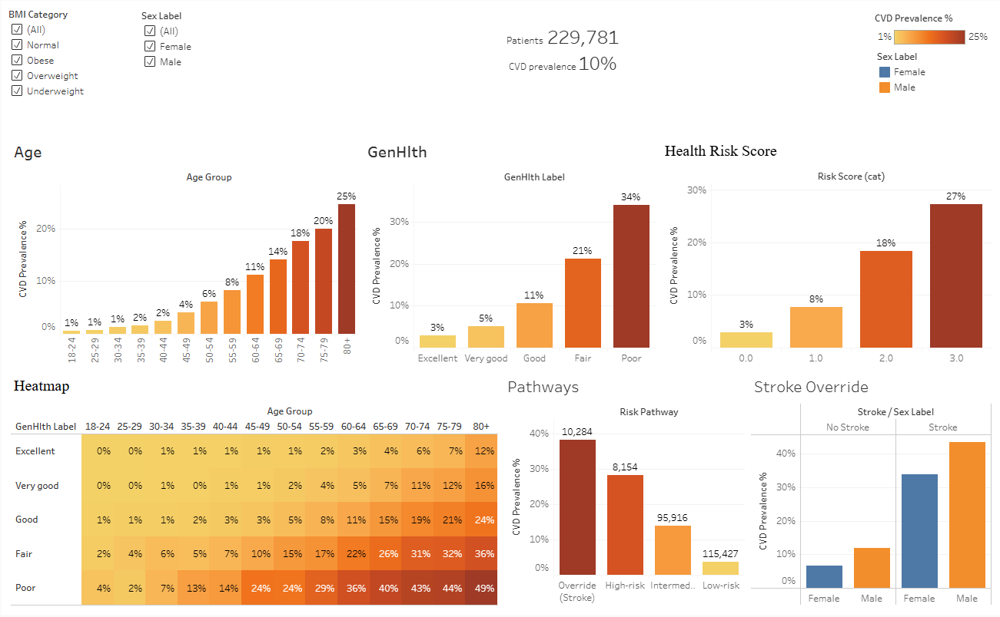

# CVD Risk Dashboard: SHAP-Guided Views of Heart Disease Risk
 
An interactive Tableau dashboard that visualizes cardiovascular disease (CVD) risk using the explainability findings (SHAP and surrogate decision trees) from my research on interpretable heart disease prediction.
 

 
**[Open the live dashboard on Tableau Public](https://public.tableau.com/app/profile/md.abrar.hasnat/viz/CVDDashboard_17957215952310/CVDRiskOverview)**
 
## Overview
 
The dashboard is organized around the top drivers identified by the XAI analysis of a weighted ensemble model (LightGBM, XGBoost and a CNN): Age, General Health, the engineered Health Risk Score, the BMI x BP interaction, and the Stroke override pathway. Instead of showing generic exploratory charts, each view maps to one explainability finding.
 
Related paper: *Interpretable Heart Disease Prediction via a Weighted Ensemble Model: A Large-Scale Study with SHAP and Surrogate Decision Trees* (Hasnat, Jobayer, Shawon, Alam).
 
Key results from the study:
 
| Metric | Value |
|---|---|
| Patients (after removing duplicates) | 229,781 |
| Positive class prevalence | about 10.3% |
| Ensemble test AUC | 0.8371 |
| Ensemble recall (screening profile) | 80.0% |
| Surrogate tree fidelity | 89.9% |
 
## Dashboard Views
 
| View | What it shows | XAI link |
|---|---|---|
| KPIs | Patient count and CVD prevalence | Context |
| Age | CVD prevalence by age group | Top SHAP feature |
| GenHlth | CVD prevalence by self-reported general health | Second SHAP feature |
| Health Risk Score | Prevalence by combined HighBP, HighChol and Diabetes score | Third SHAP feature |
| Heatmap | Age group by general health interaction | Interaction of top features |
| Pathways | Prevalence across low-risk, high-risk, intermediate and stroke override groups | Surrogate decision tree |
| Stroke Override | Prevalence with and without stroke, split by sex | Override and sex nuance |
 
Interactive filters for Sex and BMI Category apply to all views, and clicking a chart filters the others.
 
## Repository Contents
 
| File | Description |
|---|---|
| `CVD Dashboard.twb` | Tableau workbook |
| `Heart Disease Health Indicators Dataset.csv` | Original BRFSS 2015 dataset (253,680 rows, 22 columns) |
| `cvd_dashboard.csv` | Cleaned dataset with engineered features, used by the dashboard |
| `cvd_dashboard.ipynb` | Python notebook for data preparation and feature engineering |
| `screenshot.png` | Preview image of the dashboard |
 
## Data Preparation
 
The notebook processes the raw dataset before it is loaded into Tableau:
 
1. Remove duplicate rows (253,680 down to 229,781 records).
2. Engineer features used in the paper: `Health_Risk_Score` (HighBP + HighChol + Diabetes), `BMI_BP_Interaction` (BMI x HighBP) and `BMI_Category`.
3. Add readable labels for age groups, sex and general health.
4. Assign each patient to a risk pathway that approximates the surrogate tree logic.
5. Export the result as `cvd_dashboard.csv`.
## How to Use
 
**View online:** open the [Tableau Public link](https://public.tableau.com/app/profile/md.abrar.hasnat/viz/CVDDashboard_17957215952310/CVDRiskOverview).
 
**Run locally:**
 
1. Clone this repository.
2. Open `cvd_dashboard.ipynb` to reproduce the cleaned data (optional).
3. Open `CVD Dashboard.twb` in Tableau Desktop and, if prompted, point the data source to `cvd_dashboard.csv`.
## Notes and Limitations
 
- The charts show observed prevalence in the data. They are descriptive and are not SHAP values themselves.
- The risk pathway groups use simplified thresholds that approximate the surrogate tree, so they are illustrative rather than an exact reproduction of the fitted tree.
- The data comes from a self-reported survey, so results reflect associations and should not be used for clinical decisions.
## Data Source
 
Teboul, A. *Heart Disease Health Indicators Dataset* (derived from the CDC BRFSS 2015 survey), CC0 1.0 Public Domain. Available on [Kaggle](https://www.kaggle.com/datasets/alexteboul/heart-disease-health-indicators-dataset).
 
## Author
 
**Md Abrar Hasnat**
Research Assistant, BIOSE Lab, BRAC University
[Tableau Public profile](https://public.tableau.com/app/profile/md.abrar.hasnat)
 
